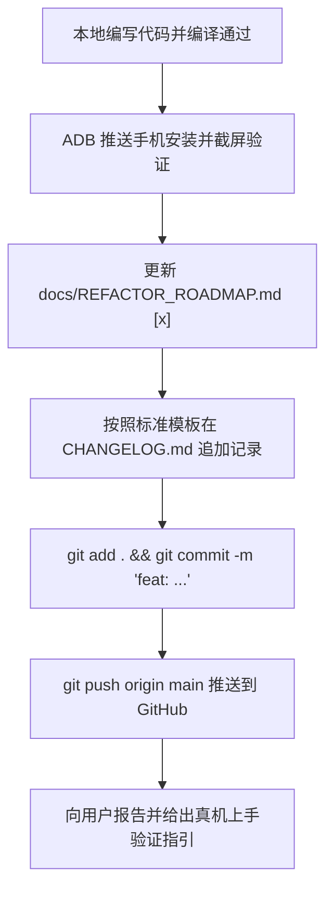

# MobileBox: Agent 与开发者交接操作完全指南 (Handover & Ops Manual)

> **文档目的**：本手册是任何新接手本项目的 AI Agent 或人类工程师的**首要行动指南**。  
> 详细规定了**工作目录结构**、**本地环境启动变量**、**交接文档编辑与维护 SOP**、**修改日志 (CHANGELOG) 记录规范**以及**代码提交流水线**。

---

## 1. 工作目录与关键路径全景 (Workspaces & Paths)

新接手的 Agent 必须严格基于以下绝对路径展开工作，严禁随意在临时目录创建散乱工程：

| 资源类别 | 物理绝对路径 / 配置 | 详细说明 |
| :--- | :--- | :--- |
| **重构工程根目录** | `/Users/damon/Documents/MobileBox` | 移动端原生主工程，所有代码、资源与 Git 仓库所在地 |
| **原项目参考代码** | `/tmp/sayxiaoyan_Box` | 原 TVBox 电视版源码仓库（参考其爬虫与解析逻辑） |
| **源项目 GitHub** | `https://github.com/sayxiaoyan/Box` | 原版 TVBox 上游开源仓库 |
| **目标 GitHub 仓库**| `https://github.com/353154/MobileBox` | 本移动端工程远程主仓库（默认分支：`main`） |
| **JDK 17 本地路径** | `/Users/damon/.tools/jdk-17.0.21+9/Contents/Home` | 独立免安装 OpenJDK 17 根目录 |
| **Android SDK 路径**| `/Users/damon/Android/sdk` | 包含 platform-34 与 build-tools 34.0.0 |
| **ADB 工具路径** | `/Users/damon/platform-tools/adb` | 真机调试与安装推流工具 |
| **真机实测设备** | 设备型号: `CPH2723` (Android 17, arm64-v8a)<br>ADB 序列号: `3B1F67EA9BBUHK76` | 已物理连接至此电脑，支持免确认静默安装与截屏 |

---

## 2. 编译构建与真机调试常用命令 (Command Cheatsheet)

每次执行 Gradle 编译或真机操作，请确保导入专属环境变量：

```bash
# 1. 设置构建环境
export JAVA_HOME=/Users/damon/.tools/jdk-17.0.21+9/Contents/Home
export ANDROID_HOME=/Users/damon/Android/sdk
export PATH=$JAVA_HOME/bin:$ANDROID_HOME/cmdline-tools/latest/bin:/Users/damon/platform-tools:$PATH

# 2. 进入主工程目录并执行编译
cd /Users/damon/Documents/MobileBox
./gradlew assembleDebug --no-daemon

# 3. 自动安装至已连接的手机并拉起
adb install -r app/build/outputs/apk/debug/app-debug.apk
adb shell am start -W -n com.damon.mobilebox/.ui.main.MainActivity

# 4. 抓取真机当前画面截图 (留档用于汇报验证)
adb exec-out screencap -p > ~/.gemini/antigravity/brain/431611a4-57c4-4ea0-890f-5c6f58a4e4d0/screenshots/step_xxx.png
```

---

## 3. 交接文档如何编辑与修改 (Documentation Maintenance SOP)

当接手的 Agent 每完成一个小步（Step X.X）的开发与真机验证后，**必须严格按以下顺序同步更新交接文档**：

### 步骤 A：更新路线图 `docs/REFACTOR_ROADMAP.md`
- 找到对应的步骤条目，将未完成状态 `- [ ]` 更改为已完成 `- [x]`；
- 如该小步在实施过程中有关键补充细节，可在该条目的“验证方法”下方追加说明。

### 步骤 B：如果涉及架构/依赖变动，更新 `docs/ARCHITECTURE.md`
- 新增依赖库时：检查并更新第 2 节的技术栈基准表；
- 新增模块或分层变更时：更新 Mermaid 架构拓扑图。

---

## 4. 修改日志 (CHANGELOG) 记录与审计规范

所有 Agent 严禁在修改代码后不记录日志。每次完成一个小步验证并准备提交 Git 前，**必须在 `CHANGELOG.md` 顶部追加记录**。

### 日志记录标准模板：
```markdown
## [YYYY-MM-DD] Step X.X 完成：<小步中文名称与目标>

### 👨‍💻 操作人员 / Agent
- **角色**：Senior Android Architect & Kotlin Specialist (Antigravity Agent)
- **任务目标**：<一句话阐明本小步解决的核心痛点与实现功能>

### 📝 核心改动文件明细
1. `<模块路径/文件名>`：<做了什么改动，如移除 TV 遥控逻辑，重写为触摸滑动手势>
2. `<模块路径/文件名>`：<新增或重构的内容>

### 📱 真机实测验证状态
- **安装状态**：`adb install -r` 成功 (APK 体积: X.X MB)
- **真机运行现象**：<描述在手机屏幕上点击、滑动、旋转的具体表现>
- **Logcat 核心日志**：`<摘录关键无报错的运行日志>`
- **真机截图归档**：`<截图物理路径>`

### 🌐 Git 提交与同步
- **Commit Hash**：`<本次 Git 提交短 Hash>`
- **GitHub 远程同步**：已同步推送至 `origin/main`
```

---

## 5. Git 持续交付与远程同步铁律



**红线禁令**：
1. 严禁把 `app/build/` 目录下的编译缓存提交到 Git（必须依赖 `.gitignore` 过滤）；
2. 严禁积压多个小步不推送，必须做到**一步一验、一步一记、一步一推**！
